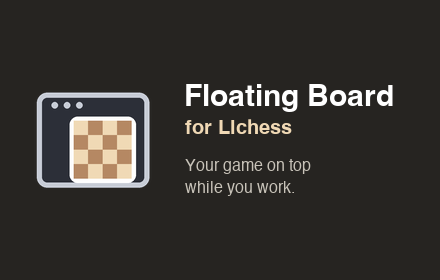

# Floating Board for Lichess

A Chrome/Edge extension that puts the board, clocks and player names of your ongoing Lichess game in a small floating window that stays on top of other apps. Play your moves while you work, without switching tabs.

## How it works

1. Open a game you are playing on [lichess.org](https://lichess.org).
2. Click **Float board** (bottom right) or press **Alt+P**.
3. The board moves into a floating window. Click or drag to move, just like on Lichess.
4. Close the window and everything returns to the Lichess tab.

The extension does not draw its own board. It uses Chrome's [Document Picture-in-Picture API](https://developer.chrome.com/docs/web-platform/document-picture-in-picture) and moves Lichess's own board elements into the floating window, so Lichess keeps running the game.

## Fair play

The extension only changes *where* the board is shown. It contains no engine, no analysis and no move suggestions, and it does not read or send game data.

## Privacy

No data is collected or sent anywhere. Only the size of the floating window is saved, locally in your browser. See the [privacy policy](docs/privacy.html).

## Requirements

Chrome or Edge 116 or newer, desktop.

## Install from source

1. Clone this repository.
2. Open `chrome://extensions`, enable **Developer mode**.
3. Click **Load unpacked** and select the repository folder.

## Development

No build step: `manifest.json` (Manifest V3), `content.js` and the translations in `_locales/` are everything.

- All Lichess selectors live in the `SELECTORS` constant at the top of `content.js`. When Lichess changes its layout, that is the place to look first.
- Set `DEBUG = true` in `content.js` for console logging.
- `./scripts/package.sh` builds `dist/floating-board-for-lichess-<version>.zip` for the Chrome Web Store and Edge Add-ons.
- Store texts and images are in `store/`.

### Known limitations

- Chessground listens for mouse events on the main document; the extension forwards them from the floating window. If dragging breaks after a Lichess update, look there first (`forwardPointerEvents`).
- One game per window: on a rematch or new game, Lichess loads a new page and the floating window closes.
- Closing the floating window does not bring the Lichess tab to the front.

## License

[MIT](LICENSE). Floating Board for Lichess is an independent project and is not affiliated with or endorsed by lichess.org.
